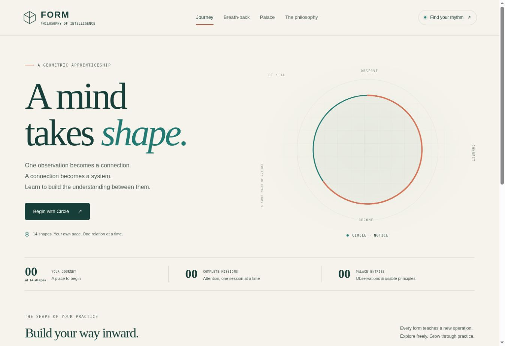

# FORM

**A geometric apprenticeship in relational reasoning.**

[**Play FORM →**](https://dream-unity.github.io/Philosophy-of-intelligence/) · [Practice guide](docs/PRACTICE_GUIDE.md) · [Offline edition](dist/FORM-Offline.html)



FORM turns a philosophy of intelligence into a sequence of small, playable operations: notice an aspect, preserve its source, connect relationships, map a structure, derive a function, and revise it when the evidence changes. Fourteen geometric forms give the journey a visual language.

The accompanying **70–200 scale is symbolic**. It does not measure IQ, classify people, set entry requirements, or promise cognitive gains. Progress describes performance on FORM's authored exercises. The curriculum and its mastery thresholds are design choices, not validated measures of general intelligence.

## Play locally

Use a current desktop or mobile browser. No account, API key, runtime dependency, external font, or downloaded audio is required.

The single-file edition is [dist/FORM-Offline.html](dist/FORM-Offline.html). Download the included file and open it directly in your browser. It contains the game's styles, scripts and vector artwork.

To run the source edition with a consistent browser storage origin, serve the repository locally:

```bash
python3 -m http.server 8000
```

Then open [http://localhost:8000](http://localhost:8000). Keep the same browser and address when returning to saved progress. Browsers can treat storage for directly opened files differently; export a backup before moving files or changing how you open the game.

## Develop and verify

Node.js 20 or later is required for the development commands. There are no npm dependencies to install.

```bash
npm test
npm run build
npm run check
```

The tests exercise the curriculum, scoring, progression, geometry, breathing clock and model lab. The build packages the offline edition. The check command performs repository and output checks. The source application is plain HTML, CSS and JavaScript; a development server or compilation step is not needed to edit it.

## A first session

1. Open **Journey** and choose **Circle**. Every shape is available from the beginning.
2. Read the short lesson and inspect a worked challenge.
3. Start a **Guided** mission of eight scored challenges. Hints and source reveals support learning; an assisted answer remains assisted in the record.
4. Read the feedback and keep a useful principle in the **Palace**.
5. When ready, choose **Independent** practice. Twenty challenges provide a practical starting point for a mastery check, provided the attempts remain unaided.

Both modes offer **8 or 20 scored challenges**. Warmup records are additional and unscored. There is no response deadline. Mission settings stay fixed until the mission ends, and breathing does not advance a challenge or determine an answer's correctness.

In **Square → Guided**, begin with one comparison lens: colour, shape or value. Choose **Mixed** when you want the requested feature to vary; independent Square missions use mixed features. The exact earlier record still matters whichever lens you choose. Connection, ordering and mapping exercises draw your construction as you make it, so the relationship can be inspected alongside the source and feedback.

## The fourteen forms

Each stage foregrounds one new operation while reusing earlier operations. The geometry is a teaching metaphor; side counts and dimensions do not establish a scientific ranking of minds.

| Form | Symbolic label | Operation | Practice |
| --- | ---: | --- | --- |
| Circle | 70 | Notice | Select one relevant feature. |
| Half-circle | 80 | Bind | Recall an item together with its location. |
| Triangle | 90 | Connect | Combine stated relations into a directed inference. |
| Square | 100 | Return | Retrieve the exact N-back observation and compare a declared feature. |
| Pentagon | 110 | Contextualise | Choose a comparison using its context, including insufficient information. |
| Hexagon | 120 | Organise | Reconstruct a system's supplied dependencies. |
| Triangular prism | 130 | Map | Preserve three corresponding roles across systems. |
| Heptagon | 140 | Abstract | Derive, apply and predict with a rule. |
| Octagon | 150 | Bound | Check the conditions under which a function applies. |
| Cube | 160 | Coordinate | Align four stated roles across accounts. |
| Dodecahedron | 170 | Select | Retrieve and apply the relevant function from a small library. |
| Icosahedron | 180 | Discriminate | Choose a diagnostic test and update competing explanations. |
| Geodesic sphere | 190 | Repair | Diagnose and correct a specific lag, role or scope error. |
| Sphere | 200 | Revise | Connect a function, prediction and evidence-led revision. |

## Explore the model lab

Open **The philosophy** and scroll to **How far does a pattern hold?** One example, green `2 → 4`, fits both “add two” and “double.” Reveal further evidence, choose a provisional rule, change the input or context, and commit a prediction before revealing the machine's output.

The lab makes four working ideas inspectable: **strength** through supporting and conflicting cases; **density** through the relationships connecting a model; **parameters** through settings you can vary; and **horizon** through the conditions beyond which a model gives no support. A calculation outside the reference region is labelled an extrapolation. Predictions and observations remain visible when you revise.

This is an authored toy world, not evidence for a universal rule. It is **unscored, does not affect mastery, and is not saved or exported**. Resetting or reloading clears its experiments.

## Progress means demonstrated practice

Progress is stage-specific. Success on an easier form does not award mastery on another form.

- **Explored:** an attempt has been recorded.
- **Practised:** a completed session contains at least six qualifying attempts with at least 75% whole-challenge accuracy. The interface offers missions of eight or twenty challenges.
- **First independent check:** one recorded date meets the independent criteria below.
- **Independent mastery:** two distinct recorded dates meet those criteria at the same lag and lag unit.

Each qualifying date needs at least **20 unaided independent attempts from completed sessions**, at least **85% whole-challenge accuracy**, and at least **85% accuracy in every channel required by that stage**. Tutorials, warmups and assisted attempts cannot supply independent mastery evidence. Attempts are grouped by their recorded UTC date; two dates do not necessarily mean a full 24-hour interval.

Where nonmatch trials occur, nonmatch accuracy must also reach **90%**. Square additionally requires at least five match and five nonmatch trials on each qualifying date. Its source-binding and relational-comparison channels are assessed separately, so a correct comparison cannot conceal retrieval of the wrong episode. Several completed sessions on the same date can contribute to that date's evidence.

These thresholds are transparent practice rules. A mastery badge is not a psychometric result or evidence of broader cognitive transfer.

## Breath-back and the Palace

The **Breath-back studio** supports private, free exploration alongside the authored exercises. Notice an image, phrase, sound or sensation; give it a location; compare it with an earlier committed observation; and, where useful, propose a function to test. Each stage offers a bridge from the game into this practice.

Private experience is not automatically graded for truth. “No clear relation” and uncertainty are acceptable. A function may be an equation, a conditional rule or a procedure; record its conditions and what could change your mind. Sources remain as first recorded, while later interpretations are added as revisions.

The Palace holds learned principles and personal observations. The authored challenges have answer keys. Personal entries have provenance and revision history rather than invented correctness scores.

From **Heptagon** onward, the studio offers **Give this pattern something to predict**. Record a situation, an expected observation and a result that would make you revise it. Later, open that entry in the Palace and use **Return with an observation** to add what happened, whether you judge it to support or challenge the prediction (or leave it unclear), and any revision. The original prediction stays visible. These records remain private and unscored.

The optional breathing guide starts at **4 seconds in / 4 seconds out**, adjustable from **2–8 seconds per phase**, with **no holds**. Sound is optional and off by default. Use your own comfortable rhythm, take additional cycles, or turn the guide off. Do not force depth or pace; stop if dizzy or unwell. The guide does not sense breathing or assess health. It pauses when the page is hidden.

## Saving, privacy and portability

FORM stores progress in the current browser's local storage. It has no account sync, analytics, AI service or automatic upload. Browser storage is not encrypted storage; someone with access to the same browser profile may be able to read it.

Use **Palace → Export** for a JSON backup. **Private journal entries, private Palace entries and an unfinished session are excluded by default.** Choose to include private material for a complete backup of committed records. FORM uses compact JSON; its own valid backups can be re-imported without shortening the included private text. Unsaved form drafts and model-lab experiments are not exported.

The Palace and journal share an **8 MiB collection budget**, with at most 128 Palace entries and 100 journal entries. If a new entry or revision would exceed a limit, it remains an unsaved draft in the open form; existing private records are not shortened to make room. Export and remove older entries before trying again. Copy an unsaved draft before closing or reloading.

Practice history is a rolling record of up to **3,000 attempts and 1,000 sessions**, with a **4 MiB limit for each log**. Export periodically to preserve older practice evidence. Imports accept files up to **32 MiB**, subject to the collection and record limits.

Your browser may allow less storage than these application limits. If saving fails, a warning explains that the latest work remains only in the tab; export it before leaving. If another tab saves newer progress, the older tab pauses and blocks further writes. Its banner lets you **export that tab's records** or **reload the saved version**; the tabs do not merge automatically.

Export before clearing browser data or resetting the game. Private source attachments used during development are not included in this repository or the offline build.

If saved data cannot be read or validated, FORM pauses automatic saving and offers the original value as a recovery download. It does not replace the original with an empty record. Import a valid backup or explicitly start a new local record to continue saving.

## GitHub Pages hosting

The game is available at [dream-unity.github.io/Philosophy-of-intelligence](https://dream-unity.github.io/Philosophy-of-intelligence/). It is served as static files from this repository.

To host a fork, in its GitHub **Settings → Pages**, choose deployment from a branch, select the branch containing the app and the root folder, then save. Exact settings depend on the repository's permissions and current GitHub interface. The app uses relative asset paths and does not require a server API.

Alternatively, publish the generated static output with your preferred static-host workflow. Hosting the application does not synchronise visitors' local progress. A hosted address and a locally opened offline file have separate browser storage.

## Design and sources

- [Practice guide](docs/PRACTICE_GUIDE.md): a flexible visit-by-visit schedule from Circle to Sphere.
- [Verification record](docs/VERIFICATION.md): automated checks, browser playthroughs and known limits.
- [Design rationale](docs/DESIGN.md): progression, source integrity, assessment and privacy decisions.
- [Reference notes](docs/REFERENCE_NOTES.md): conceptual influences and evidence boundaries.
- [Implementation contract](docs/IMPLEMENTATION_CONTRACT.md): module interfaces and runtime invariants.

FORM implements a proposed practice architecture. Improvements on its tasks would not, by themselves, establish IQ improvement, clinical benefit or transfer to everyday reasoning. Those claims would need separate research.
